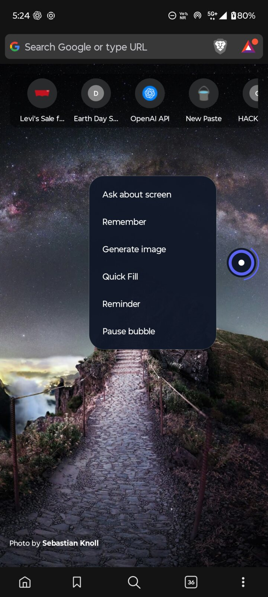
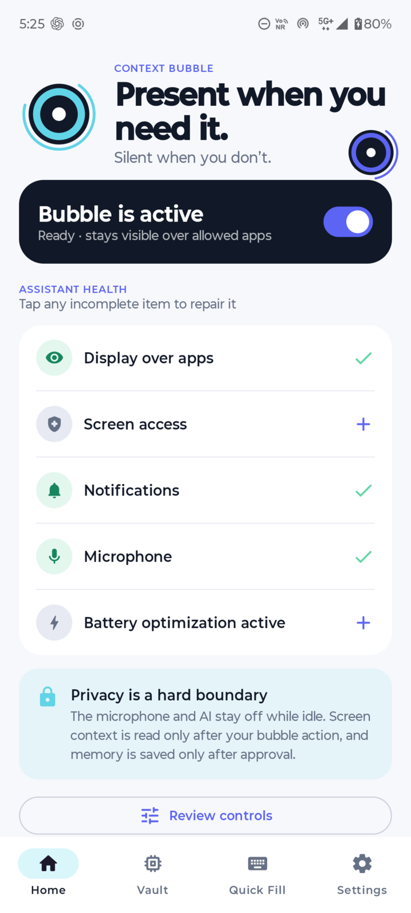
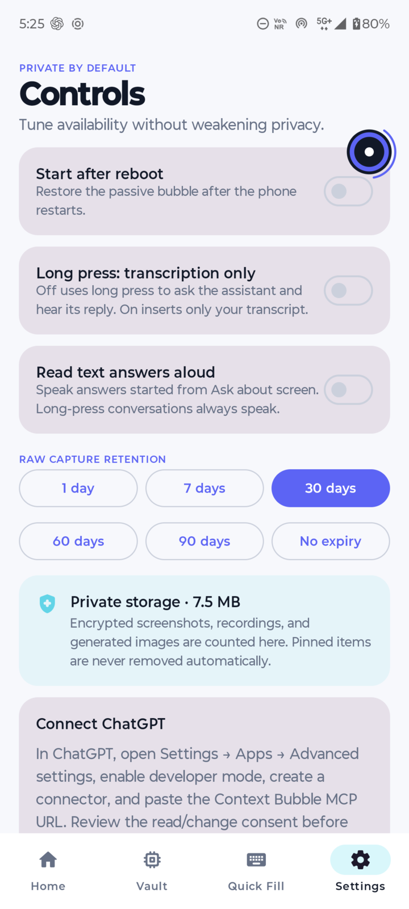
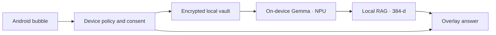

# Context Bubble

**A privacy-first Android assistant that stays beside your work instead of pulling you away from it.**

Context Bubble is a lightweight, edge-docked assistant for Android 13+ that understands a screen only when you tap it, answers over the current app, and keeps only the memories you approve.

It solves a simple friction: context is trapped where it appeared. A message saying “email me on Tuesday” normally means switching apps, copying, and re-explaining. Bubble turns that into one tap where you already are.

> **iQOO Hackathon 2026 · City Battles** — Prototype built during iQOO Hackathon 2026 — Aug 25-30, Bengaluru — fully on-device (Gemma on NPU, local embeddings, notification triage).

## See it in action

<table>
  <tr>
    <td align="center"></td>
    <td align="center"></td>
    <td align="center"></td>
  </tr>
  <tr>
    <td align="center"><strong>Available in the current app</strong><br>Ask, remember, generate, fill, or create a reminder.</td>
    <td align="center"><strong>Permission health at a glance</strong><br>Every missing capability has a visible repair path.</td>
    <td align="center"><strong>Private by default</strong><br>Voice mode, retention, and encrypted storage stay user-controlled.</td>
  </tr>
</table>

## How it works

1. The bubble remains quietly docked to a safe screen edge over allowed applications.
2. The user taps it and chooses **Ask about screen**, **Remember**, **Generate image**, **Quick Fill**, or **Reminder**.
3. Context Bubble checks the current package and sensitive-screen policy before reading anything.
4. It captures only the context needed for that explicit request and streams the result into an overlay over the current app.
5. The user can copy, save, edit, confirm, retry, or close the result. External writes always receive an exact preview and confirmation.

A long press starts a live assistant conversation by default. An optional setting turns the same gesture into transcription-only mode, which inserts into the focused field and preserves the transcript in the clipboard if insertion fails.

## What you can do

- **Ask & talk:** understand, summarize, translate or draft from the current screen; Realtime voice with interruption and transcription fallback.
- **Dictate & remember:** polished speech insertion with wrong-target protection; review a structured memory before saving locally.
- **Generate & fill:** create an image from screen context; Quick Fill inserts names/emails/phones/addresses (cards/OTPs blocked).
- **Reminders & vault:** extract time/recurrence and confirm a local reminder; browse memories, transcripts and captures with retention controls.

## Memory that the user owns

Context Bubble separates data into three lanes so “using context” never silently becomes “remembering everything.”

| Lane | Purpose | Leaves the phone? |
|---|---|---|
| **Ephemeral context** | Used only for the active request, then discarded | Only the minimum request context sent to the assistant |
| **Local only** | Quick Fill, private notes, raw captures, transcripts, and vault items | No, unless explicitly shared for one action |
| **Shared AI** | User-approved facts available across Context Bubble sessions | Yes, encrypted and synchronized after sign-in |

Context Bubble also exposes its own authenticated MCP server. After the user connects it and grants access, ChatGPT can search approved Shared AI memories and prepare changes. Writes and deletes use a two-stage preview plus a ten-minute, one-use confirmation token.

This does **not** modify native ChatGPT Memory. Context Bubble remains the source of truth, and local-only data is never exposed through MCP.

## Privacy is a hard boundary

- No idle mic, screenshot, or AI request — nothing runs until you tap the bubble.
- Financial, UPI, password/OTP, biometric and permission screens are hard-blocked and can’t be weakened.
- Raw captures never enter cloud storage; generated images upload only after **Save**, encrypted.
- Screen text is untrusted; model output can’t authorize actions. All consequential writes need a preview and confirmation.
- Local files use AES-256-GCM + Keystore; private screens are excluded from backups.

## What makes it different

- **Stays in the workflow** — answers over the current app, not a separate assistant.
- **Consent-driven** — bubble is always there; capture and memory only on tap.
- **Explicit memory lanes** — ephemeral / local-only / shared can’t silently collapse.
- **Android-native** — overlays, insets, Accessibility, and recovery handled at the platform level.

## Current implementation status

| Capability | Status |
|---|---|
| Persistent overlay, in-app answer cards, Quick Fill, local vault, exclusions, and reminders | Implemented on Android — 100% local |
| Screen understanding, image generation, voice | Prototype: OpenAI via `adb reverse`; flagship: on-device Gemma on NPU |
| Encrypted local vault + on-device RAG (384-d) | Implemented; `LOCAL_ONLY` — no cloud queue, no Supabase |
| MCP / Calendar sync | Disabled in this local-only build (code retained, not wired) |
| Deterministic Accessibility automation | Lab APK only; compile-time excluded from Play |

## Key engineering decisions

| Decision | Why |
|---|---|
| Native Kotlin instead of React Native | Overlays, Accessibility, audio routing, foreground services, and autofill are platform-sensitive |
| Classic `View` for the idle bubble, Compose for the app | Keeps the always-running hierarchy small without sacrificing maintainable settings UI |
| Separate Play and Lab builds | Keeps experimental deterministic automation out of the public artifact |
| Local-first storage with three memory lanes | Prevents temporary context or private data from silently becoming shared memory |
| Context Bubble MCP instead of claiming native ChatGPT Memory sync | Gives ChatGPT explicit, revocable access to user-approved app-owned memories |

## Architecture



- Kotlin `minSdk 33`/`targetSdk 36` — Compose for the app shell, classic Views for the bubble.
- Room, DataStore, Keystore, coroutines/Flow, Hilt, and WorkManager — all slices stay on-device.
- Local vault is `LOCAL_ONLY` — no Supabase queue, no `PENDING` sync. `approvedAssistantContext` is local-only.
- Gemma on the NPU + 384-d on-device retrieval; prototype on moto g54 uses OpenAI via `adb reverse` only because the chip can’t run it — flagship is fully on-device.

## Performance and reliability

Idle path is one overlay view + an event-driven Accessibility listener — no polling or wake locks. Drag is frame-coalesced and insets are live. Tested on moto g54 5G (Android 15); suites cover gestures, insets, encryption, sync conflicts, and Play/Lab isolation (see `docs/PERFORMANCE.md`).

## Quick start and sample data

No seeded data needed:

1. Start backend + `adb reverse` (see **Local phone testing**).
2. `adb install -r app/build/outputs/apk/play/debug/app-play-debug.apk` and pass health checks (Overlay + Accessibility).
3. In Brave, show `My favourite cake is chocolate. Remind me to order one Friday at 3 PM.` → tap bubble → **Ask**, **Remember**, **Reminder**.

## Build and test

Requirements: Android SDK 36, JDK 17+, and Node.js 22+.

```powershell
.\gradlew.bat testPlayDebugUnitTest testLabDebugUnitTest lintPlayDebug assemblePlayDebug assembleLabDebug

cd backend
npm install
npm run typecheck
npm test
deno task check:edge

cd ..\oauth-consent
npm install
npm run build
```

Debug APKs are written to:

- `app/build/outputs/apk/play/debug/app-play-debug.apk`
- `app/build/outputs/apk/lab/debug/app-lab-debug.apk`

Install upgrades with `adb install -r` so the Room database, permissions, and application data survive.

### Local phone testing

```powershell
$adb = "$env:LOCALAPPDATA\Android\Sdk\platform-tools\adb.exe"
& $adb reverse tcp:8787 tcp:8787

cd backend
Copy-Item .env.example .env
npm run dev
```

For AI-only local testing, configure `OPENAI_API_KEY`, `OPENAI_MODEL_PROFILE=budget`, and a strong `INSTALLATION_TOKEN_SECRET`. Cloud, MCP, Calendar, signed policy, and production Play Integrity activate only when their complete server configuration is present. See [`backend/.env.example`](backend/.env.example) for every variable.

Release builds default to the deployed development backend. A production or compatible custom endpoint can be supplied through `MANAGED_BACKEND_URL` or the `managedBackendUrl` Gradle property; it must use HTTPS and end in `/`.

## Deployment and deeper documentation

- [Project story](aboutproject.md)
- [Cloud deployment](docs/CLOUD_DEPLOYMENT.md)
- [Threat model](docs/THREAT_MODEL.md)
- [Performance contract](docs/PERFORMANCE.md)
- [Validation record](docs/VALIDATION.md)
- [Privacy policy draft](docs/PRIVACY.md)

Production capabilities are released behind server configuration flags so a cloud failure never disables the local bubble, Quick Fill, vault, or reminders.

## Scope and limitations

- Force-stop can’t be auto-recovered; some OEMs need a manual exemption.
- Protected screens provide no context; ChatGPT sees only approved Shared AI via MCP.
- Clipboard image support varies — Share/Save are the reliable fallbacks.

## License

Context Bubble is available under the [MIT License](LICENSE). Copyright © 2026 Manjunath Patil.
