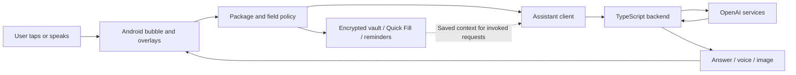

<div align="center">

# Context Bubble

### Turn what's on your screen into your next step.

A privacy-first Android assistant for answers, memories, voice, and reminders—right over the app you're using.

**iQOO Hackathon 2026 · Grand Finale**<br>
**Track: Productivity · Prototype built October 3–4, 2026 (IST)**<br>
Built from scratch by **Manjunath Patil**.

[See the app](#see-the-app) · [Features](#what-you-can-do) · [Run locally](#run-locally) · [Architecture](#architecture)

</div>

---

## The problem

Useful information arrives everywhere: a message, a browser page, a document, a form. Acting on it often means leaving the app, copying text, opening an assistant, and explaining the same context again.

**Context Bubble keeps help beside the task.** Tap the floating bubble to ask about the screen, save something worth remembering, fill a field, or create a reminder. Answers appear over the current app, and you decide what to keep.

## Why Productivity

Context Bubble addresses three everyday productivity problems:

- **Repeated context switching:** ask about the screen without opening a separate assistant.
- **Information lost between apps:** turn selected context into a reviewed memory or reminder.
- **Repetitive input:** reuse saved details through Quick Fill or dictate into a focused field.

The goal is simple: fewer interruptions between understanding something and acting on it.

## See the app

<table>
  <tr>
    <td align="center"></td>
    <td align="center"></td>
    <td align="center"></td>
  </tr>
  <tr>
    <td align="center"><strong>Help where you work</strong><br>Open actions over a supported app.</td>
    <td align="center"><strong>Visible permission controls</strong><br>Review access and repair missing permissions.</td>
    <td align="center"><strong>Storage you control</strong><br>Manage voice settings, retention, and saved captures.</td>
  </tr>
</table>

## What you can do

| Feature | In your workflow |
|---|---|
| **Ask about screen** | Ask for an explanation, summary, translation, or draft using explicitly captured screen context. Receive a streamed answer in an overlay. |
| **Remember** | Review and edit a proposed memory before saving it in the encrypted local vault. |
| **Quick Fill** | Insert saved names, email addresses, phone numbers, addresses, or snippets into a supported field. |
| **Voice and dictation** | Long-press for a live assistant conversation, or choose transcription mode to dictate into the focused field. |
| **Reminders** | Review the title, note, and schedule before creating a local reminder. |
| **Generate image** | Request an image inspired by screen context, then choose whether to save or share the result. |
| **Vault and settings** | Browse saved information, pin important items, manage retention, and exclude apps from the bubble. |

Voice insertion checks the target field again before writing. If insertion cannot complete, a clipboard fallback helps preserve the transcript.

### A short demo

1. Open a supported browser or notes app with: **“My favourite cake is chocolate. Order one for the team on October 4, 2026.”**
2. Tap **Ask about screen** to get a brief of the visible information.
3. Choose **Remember**, review the extracted preference, and save it locally.
4. Choose **Reminder**, review the schedule, and confirm it.
5. Open the vault to find the saved memory. Try **Quick Fill** in a normal text field.

This demonstrates the central loop: **screen → understanding → reviewed action**, without leaving the task to open an assistant.

## Privacy and user control

Screen capture and microphone use start through explicit interaction. The bubble does not continuously record the screen or listen to conversations.

- **Protected surfaces:** package and field checks restrict access on known financial, authentication, password, OTP, and other sensitive surfaces. User exclusions add further restrictions.
- **Encrypted storage:** vault values and capture files use AES-GCM with an Android Keystore key. Android backups are disabled for the app.
- **Reviewed actions:** memory saving and reminder creation expose editable previews. Calendar and other consequential operations use policy checks and confirmation paths.
- **Untrusted screen content:** screen text is treated as context, not authorization to execute instructions.
- **Permission visibility:** onboarding and Assistant health explain overlay, Accessibility, microphone, and notification access.

**Local storage and AI processing are different.** The current prototype uses a backend for AI. Invoked requests can send screen text, a screenshot, audio, and saved memory context to that backend and its AI provider. Saving a memory locally does not guarantee that it will never be included in a later assistant request.

See the [privacy document](docs/PRIVACY.md) and [threat model](docs/THREAT_MODEL.md) for additional design context. The implementation status below describes this source snapshot.

## Implementation status

| Area | Current source |
|---|---|
| Floating bubble, action overlays, app exclusions, and permission health | Implemented in the Android app. |
| Encrypted vault, Quick Fill, retention, and local reminder scheduling | Implemented with Android storage and platform services. |
| Screen assistance, image generation, transcription, and live voice | Backend clients and API routes are present; require a running backend and configured AI credentials. |
| Shared memory, Google sign-in, Calendar, and MCP | Integration code is present and requires additional service configuration. Automatic shared-memory enqueue and periodic cloud sync are disabled in the current app container. |
| Deterministic Accessibility automation | Experimental Lab flavor; the Play flavor uses a separate actuator implementation. |
| On-device language-model inference and local semantic retrieval | Future direction; this snapshot does not include a Gemma/NPU inference implementation. |

This is a prototype. Feature availability depends on permissions, backend configuration, and the Android device. Historical checks are recorded in [VALIDATION.md](docs/VALIDATION.md); they are not a claim that every check has been rerun against this checkout.

## Architecture



| Layer | Technology and responsibility |
|---|---|
| **Android UI** | Kotlin, Jetpack Compose for screens, classic Android Views for the bubble and overlays. |
| **Device integration** | Accessibility, foreground services, Autofill, AlarmManager, notifications, and audio handling. |
| **Local data** | Room, DataStore, Android Keystore, encrypted files, and WorkManager cleanup. |
| **Assistant transport** | OkHttp, streamed responses, Kotlin serialization, coroutines, and WebRTC voice. |
| **Backend** | TypeScript and Hono; server-side AI access, installation authentication, policies, and usage quotas. |
| **Optional cloud services** | Supabase functions and migrations, shared-memory services, Calendar integration, and MCP. |

AI provider credentials belong on the server, not in the APK.

## Run locally

### Requirements

- JDK 17 or newer.
- Android SDK 36 and a compatible build-tools installation.
- An Android 13+ phone or emulator (`minSdk 33`; target SDK 36).
- Node.js 22+ and npm for the backend.
- Server-side AI credentials for assistance, voice, and image features.

The commands below use PowerShell from the repository root. The Gradle wrapper is included.

### 1. Configure and start the backend

```powershell
Set-Location backend
npm ci
Copy-Item .env.example .env
```

Edit `backend/.env` and set:

```dotenv
OPENAI_API_KEY=<your-server-side-key>
OPENAI_MODEL_PROFILE=budget
INSTALLATION_TOKEN_SECRET=<a-random-secret-of-at-least-32-characters>
```

Keep `.env` private; it is excluded from Git. Supabase and Google credentials are only needed for the corresponding optional integrations. Review [all configuration options](backend/.env.example) before enabling them.

Start the development server and keep that terminal open:

```powershell
npm run dev
```

The default address is `http://127.0.0.1:8787`. Its health endpoint is `/health`.

### 2. Build and install the Android app

In a second terminal at the repository root, connect your phone or start an Android emulator:

```powershell
$env:ANDROID_HOME = "$env:LOCALAPPDATA\Android\Sdk"
$adb = Join-Path $env:ANDROID_HOME "platform-tools\adb.exe"

& $adb devices
.\gradlew.bat :app:assemblePlayDebug
& $adb reverse tcp:8787 tcp:8787
& $adb install -r "app\build\outputs\apk\play\debug\app-play-debug.apk"
```

Debug builds use `http://127.0.0.1:8787/`; `adb reverse` connects that address on Android to the laptop's backend. If multiple devices are connected, add `-s <device-serial>` to each ADB command.

### 3. Enable the bubble

Open **Context Bubble**, complete onboarding, and grant the requested overlay, Accessibility, and notification permissions. Grant microphone access when using voice. Enable the bubble, then try the demo above in an allowed app.

### Build variants

| Variant | Purpose | Debug APK |
|---|---|---|
| **Play** | Main app with the Play-specific actuator. | `app/build/outputs/apk/play/debug/app-play-debug.apk` |
| **Lab** | Experimental automation build. | `app/build/outputs/apk/lab/debug/app-lab-debug.apk` |

Build the Lab APK with `:app:assembleLabDebug`. Use `adb install -r` for updates to preserve application data.

Release builds require a configured HTTPS backend. Supply `MANAGED_BACKEND_URL` or the `managedBackendUrl` Gradle property; the URL must end with `/`. The source default is a placeholder Supabase URL.

## Validation commands

Android unit tests, lint, and both debug APKs:

```powershell
.\gradlew.bat testPlayDebugUnitTest testLabDebugUnitTest lintPlayDebug assemblePlayDebug assembleLabDebug
```

Backend checks:

```powershell
Set-Location backend
npm ci
npm run typecheck
npm test
```

Optional Supabase Edge Function checks require Deno, run from `backend/`:

```powershell
deno task check:edge
```

Consent-site build, run from the repository root:

```powershell
Set-Location oauth-consent
npm ci
npm run build
```

Android test sources cover policy decisions, field validation, overlay geometry, search, flavor isolation, and database migration. Performance measurements and longer device trials have their own [validation record](docs/VALIDATION.md) and [performance plan](docs/PERFORMANCE.md).

## Repository guide

| Path | Contents |
|---|---|
| [`app/`](app/) | Android app, Play/Lab source sets, database schemas, and tests. |
| [`backend/`](backend/) | Assistant API, integration services, tests, and deployment scripts. |
| [`backend/supabase/`](backend/supabase/) | Optional Edge Functions and database migrations. |
| [`oauth-consent/`](oauth-consent/) | Consent website. |
| [`docs/`](docs/) | Screenshots, deployment notes, privacy, performance, and validation. |
| [`aboutproject.md`](aboutproject.md) | Project motivation and development story. |

## Practical limits

- AI features need network access and configured services; the current prototype does not provide offline model inference.
- Android permissions and protected screens can prevent capture or text insertion. Accessibility support varies between apps.
- Force-stopping the app requires reopening it; some manufacturers also require battery-management adjustments.
- Exact reminders depend on Android alarm permissions. The scheduler falls back to an inexact alarm when necessary.
- Generated-image clipboard support varies; save and share provide additional output paths.
- Optional cloud integrations need deployment and configuration; their presence in the repository does not establish that they are active in a running build.

## Next steps

- Evaluate on-device inference and retrieval on supported hardware.
- Measure idle cost, gesture responsiveness, and voice reliability across more devices.
- Validate optional integrations end to end before enabling broader use.
- Refine the capture → preview → action experience through user testing.

## Author and license

Built from scratch by **Manjunath Patil** for the **Productivity** track of **iQOO Hackathon 2026 · Grand Finale**.

Licensed under the [MIT License](LICENSE). Copyright © 2026 Manjunath Patil.
